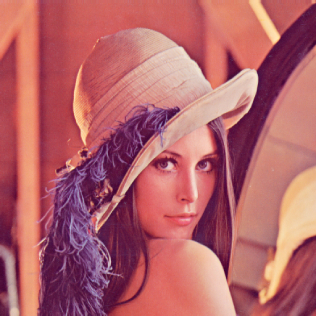
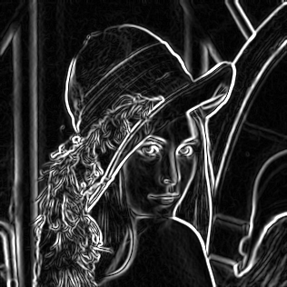
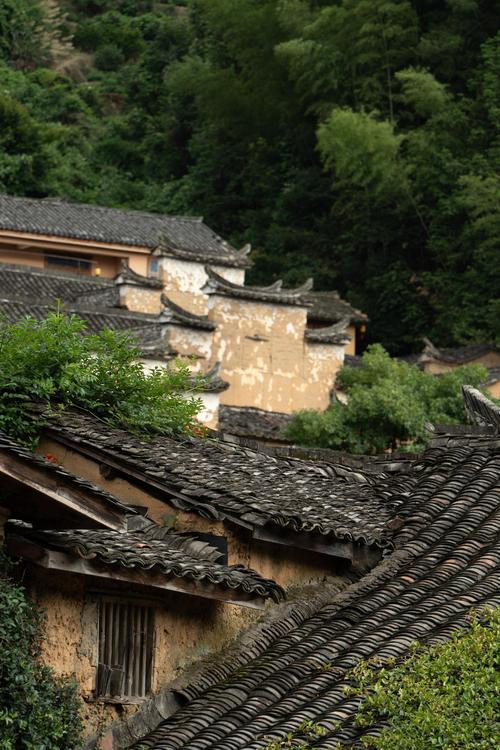
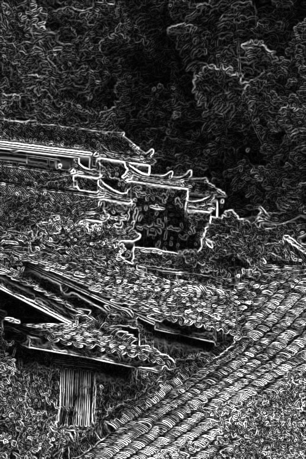
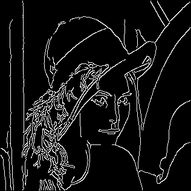
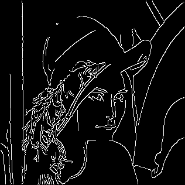
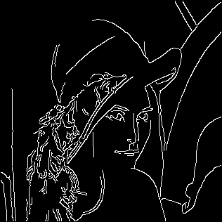
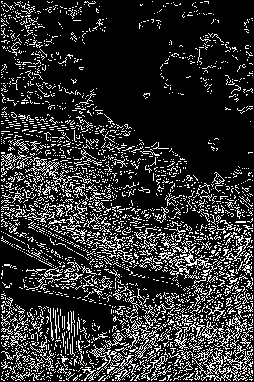
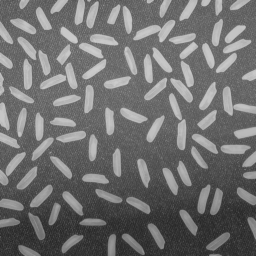
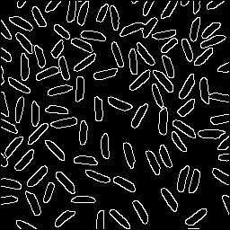

# median_sobel_canny

工业相机测量课程作业：用 C++ 手写实现 **中值滤波**、**Sobel 边缘检测**、**Canny 边缘检测** 三个算子。

图像读写借用了 [stb](https://github.com/nothings/stb) 单头文件库，**滤波、卷积、梯度、非极大值抑制、双阈值连接等算法全部自己实现**，不调用 OpenCV 的图像处理函数。

## 快速开始

```bash
# 构建（需要 CMake ≥ 3.16 和 C++17 编译器）
mkdir -p build && cd build && cmake .. && make -j
```

```bash
# 调用：final <输入图> <输出图> <处理方式> [参数]
./build/bin/final input.jpg out_sobel.png  sobel          # Sobel 边缘检测
./build/bin/final input.jpg out_canny.png  canny 50 100   # Canny，低阈值 50、高阈值 100
./build/bin/final input.png out_median.png median 5       # 中值滤波，5×5 窗口
```

| 处理方式 | 参数 | 默认值 |
| --- | --- | --- |
| `median` | 窗口边长 n（必须正奇数） | 3 |
| `sobel` | 无 | — |
| `canny` | 低阈值、高阈值（必须同时给出） | 20 / 110 |

程序会打印读入图像的尺寸、通道数和处理耗时；参数不合法（偶数窗口、Canny 只给一个阈值）会报错退出。

> CMakeLists 里保留了 `find_package(OpenCV 4 REQUIRED)`，配置阶段需要能找到 OpenCV 4；
> 当前实现没有直接调用 OpenCV 的函数，不需要的话可以把那几行连同 `target_link_libraries` 一起删掉。

## 目录结构

```
assignment_ws/
├── CMakeLists.txt
├── src/
│   ├── main.cpp              # 命令行入口，分发三种处理方式并计时
│   ├── kernels.cpp           # Sobel / 高斯卷积核、默认参数、clamp255
│   ├── convolution.cpp       # 复制边界填充 padding + 卷积
│   ├── image_io.cpp          # stb_image / stb_image_write 封装（本项目唯一定义实现处）
│   ├── median_blur.cpp       # 中值滤波（滑动直方图）
│   ├── sobel.cpp             # Sobel 边缘检测
│   ├── canny.cpp             # Canny 边缘检测
│   └── includes/             # 各模块头文件 + stb_image.h / stb_image_write.h
└── docs/images/              # README 用的原图与结果对比图
```

## 算法实现

**卷积（`convolution.cpp`）**
对原图做复制边界填充（replicate padding），使卷积输出与原图同尺寸；单点卷积结果由 `calculate_conv` 计算。

**中值滤波（`median_blur.cpp`）**
不逐像素排序，而是维护一个 256 桶的直方图：换行时重建一次，行内向右滑动时每步只从直方图里减去离开窗口的一列、加入新进入的一列，再从直方图累加找中位数，复杂度由逐像素排序的 O(H·W·k²) 降到 O(H·W·k)。多通道图逐通道拆分处理以避免通道间串色；含 alpha 的图（2/4 通道）保留 alpha 通道不滤波。

**Sobel（`sobel.cpp`）**
灰度化（BT.601：Y = 0.299R + 0.587G + 0.114B）→ 3×3 高斯核 `{{1,2,1},{2,4,2},{1,2,1}}/16` 平滑 → 分别与 x、y 方向 Sobel 核卷积 → 取梯度幅值 √(Gx²+Gy²) 并钳位到 0~255，输出单通道灰度图。

**Canny（`canny.cpp`）**
1. 灰度化 + 高斯平滑（Canny 对噪声敏感）；
2. Sobel 求 Gx、Gy，同时用 `atan2` 求梯度方向并归一到 [0°, 180°)；
3. 非极大值抑制：按梯度方向落入的 4 个扇区（水平 / 主对角 / 竖直 / 副对角），只保留幅值不小于两侧邻点的点；
4. 双阈值二值化：幅值 ≥ 高阈值标为强边缘，介于两阈值之间标为弱边缘候选；
5. 弱边缘连接：以所有强边缘为起点做 BFS，8 邻域内连通的弱边缘提升为强边缘，最终输出 255/0 的二值边缘图。

## 结果对比

### Sobel 边缘检测

| 原图 | Sobel |
| --- | --- |
|  |  |
|  |  |

### Canny 边缘检测：不同双阈值（Lenna）

| 原图 | 50 / 100 | 50 / 150 | 80 / 150 | 80 / 180 |
| --- | --- | --- | --- | --- |
|  |  |  |  |  |

阈值提高后弱边缘被丢弃，残留的强边缘更少、更干净。

### Canny 边缘检测：其他测试图（50 / 100）

| 原图 | Canny |
| --- | --- |
|  |  |
|  |  |

### 中值滤波：不同窗口（butterfly）

| 原图 | 3×3 | 5×5 | 15×15 |
| --- | --- | --- | --- |
|  |  |  |  |

窗口越大平滑越强，细节（翅脉、触角）随之丢失；含 alpha 的图 alpha 通道不参与滤波。

## 说明

- 输出图像统一由 `stbi_write_png` 写出，**输出格式恒为 PNG，与文件名的扩展名无关**（例如命名为 `out.jpg` 时内容仍是 PNG）。README 里的结果图即按真实内容以 `.png` 命名。
- stb 两个头文件的实现只在 `image_io.cpp` 中定义一次（`STB_IMAGE_IMPLEMENTATION` / `STB_IMAGE_WRITE_IMPLEMENTATION`），其余文件只包含声明，避免重复符号。
- 展示图来自本地 `result/`；butterfly 系列为便于网页展示从 2000×2000 缩放到 800×800（保留 alpha 通道），其余为原始输出。
